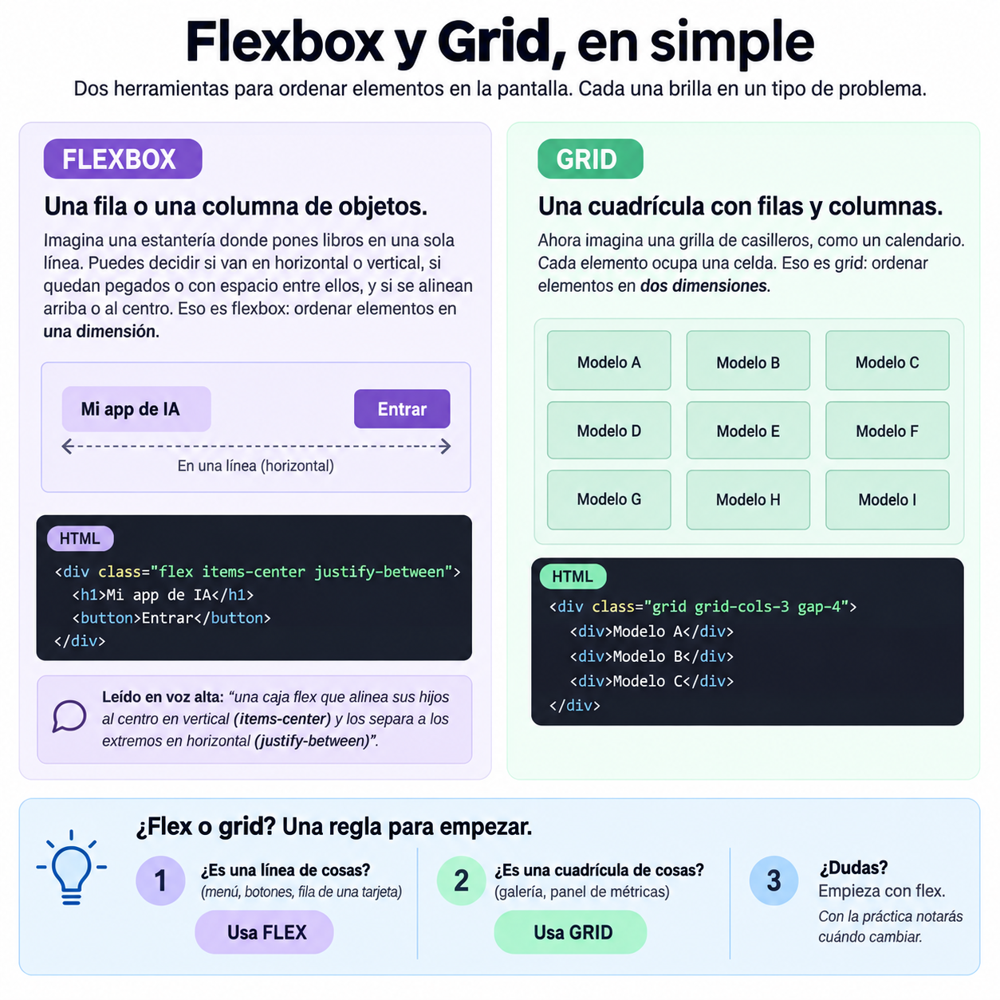
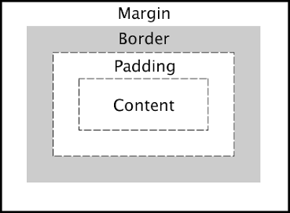
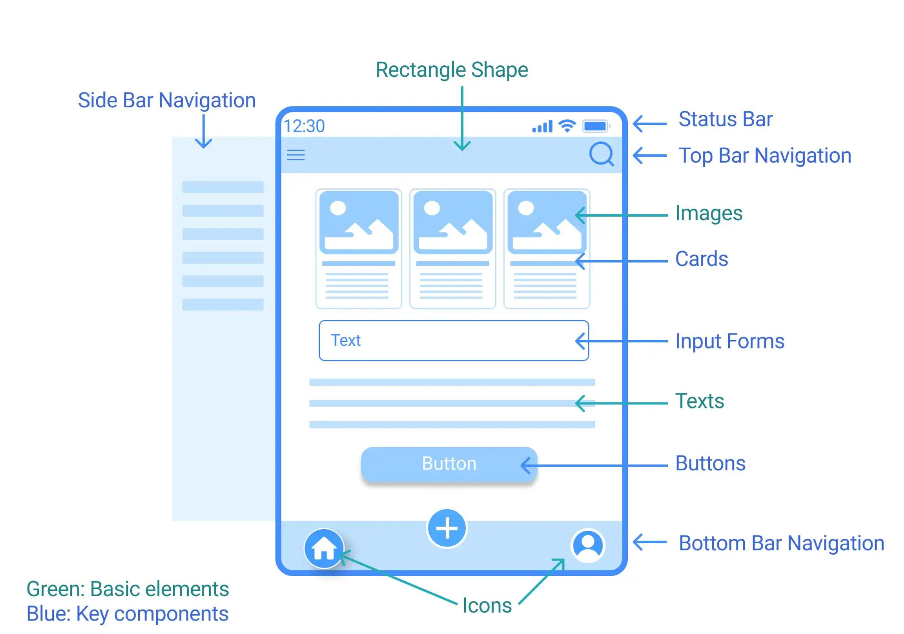

# Interfaces con Tailwind CSS: de la idea a la pantalla

Casi todo lo que construyes en IA termina frente a una persona: un chat, un panel con métricas, un formulario que envía un prompt, una tarjeta que muestra la respuesta de un modelo. Si no sabes armar esa pantalla, dependes de otra persona para mostrar tu trabajo. La idea para esta clase es entender los siguientes temas:

1. **Mastering Web Layout Architecture:** cómo se organiza el espacio de una página.
2. **Web Component Recognition and Structure:** cómo identificar y descomponer botones, tarjetas, menús y formularios.
3. **Responsive Web Design:** cómo adaptar la misma interfaz a distintos tamaños de pantalla.
4. **Tailwind CSS Fundamentals:** el sistema de clases de utilidad y cómo leerlo.

## Layout, pensar en cajas

Todo lo que ves en una página web es una caja dentro de otra caja. Aprender layout es aprender a decidir **cómo se acomodan esas cajas**.

### Flexbox y Grid




### El modelo de caja: tres capas



El Modelo de Caja (Box Model) define la estructura de todo elemento en la web. En Tailwind CSS, se controla de adentro hacia afuera usando una escala predecible (donde 1 = 0.25rem / 4px):

| Capa | Definición | Clases clave en Tailwind |
| --- | --- | --- |
| Content | El núcleo (texto, imagen, vídeo). | `w-64`, `h-32` |
| Padding | Espacio interno (papel burbuja dentro de la caja). | `p-4`, `px-6`, `pt-2` |
| Border | La pared o contorno delimitador. | `border`, `border-2`, `border-blue-500` |
| Margin | Espacio externo (distancia con los vecinos). | `m-4`, `my-8`, `mx-auto` |


## Reconocer componentes

Un componente es una pieza de interfaz con un propósito claro y partes reconocibles. Si aprendes a **ver las partes**, dejas de ver "una pantalla complicada" y empiezas a ver piezas que ya sabes armar.

### Anatomía de los componentes más comunes

| Componente | Para qué sirve | Partes típicas |
| --- | --- | --- |
| Botón | Ejecutar una acción | Texto, color de fondo, padding, borde redondeado, estado al pasar el mouse |
| Tarjeta (card) | Agrupar información relacionada | Contenedor, título, texto, imagen o ícono, acción |
| Barra de navegación | Moverse entre secciones | Logo, enlaces, botón de acción |
| Formulario | Recoger datos | Etiqueta, campo de texto, mensaje de ayuda, botón de envío |
| Mensaje de chat | Mostrar quién dijo qué | Avatar, burbuja, texto, hora |




## Responsive, una interfaz para todas las pantallas

La misma página la verá alguien en un celular pequeño y alguien en un monitor grande. **Responsive** significa que tu diseño se adapta en lugar de romperse.

### Mobile first: diseña primero para el celular

En Tailwind empiezas escribiendo el diseño para pantallas pequeñas. Luego agregas cambios para pantallas más grandes con **prefijos de tamaño**:

| Prefijo | Se aplica desde | Ejemplo de uso |
| --- | --- | --- |
| (sin prefijo) | Pantallas pequeñas (celular) | `grid-cols-1` |
| `sm:` | 640 px | Celulares grandes |
| `md:` | 768 px | Tablets |
| `lg:` | 1024 px | Laptops |
| `xl:` | 1280 px | Monitores grandes |

Los prefijos significan "desde este ancho hacia arriba". Un `md:grid-cols-3` quiere decir: "a partir de 768 px, usa tres columnas".

```html
<div class="grid grid-cols-1 gap-4 md:grid-cols-2 lg:grid-cols-3">
  <div>Tarjeta 1</div>
  <div>Tarjeta 2</div>
  <div>Tarjeta 3</div>
</div>
```

Leído en voz alta: "una columna en celular, dos en tablet, tres en laptop".


### Cómo comprobarlo

Abre las herramientas de desarrollo de tu navegador y activa el **modo dispositivo** en el proyecto de ejemplo de esta clase. Arrastra el borde de la ventana y mira cómo cambia el diseño. Ver el cambio en vivo es lo que fija la idea.

### Estados: la interfaz reacciona

Los prefijos también sirven para estados. Se leen como "cuando pase esto, aplica esto":

```html
<button class="bg-blue-600 text-white px-4 py-2 rounded-lg
               hover:bg-blue-700 focus:ring-2 focus:ring-blue-300">
  Enviar
</button>
```

`hover:` es cuando pasas el mouse y `focus:` es cuando el elemento está seleccionado con el teclado. Este último importa para la accesibilidad.

### Cómo leer una línea de clases

Cuando veas un montón de clases, no las leas de corrido. Agrúpalas por familia y de izquierda a derecha:

`bg-blue-600 text-white px-4 py-2 rounded-lg` se lee: fondo azul, texto blanco, relleno horizontal 4 y vertical 2, esquinas redondeadas. Eso es un botón.

## Errores comunes (y por qué son buenas noticias)

Equivocarte es parte del aprendizaje: cada error que ves en pantalla y corriges deja una huella más fuerte que un acierto a la primera. Esta tabla reúne los más frecuentes.

| Síntoma | Causa probable | Cómo arreglarlo |
| --- | --- | --- |
| Los estilos no se aplican | Falta cargar Tailwind o hay un error en el nombre de la clase | Revisa la etiqueta `<script>` y compara el nombre de la clase con la documentación |
| Los elementos no se alinean | Olvidaste `flex` en el contenedor padre | `items-center` y `justify-between` solo funcionan si el padre tiene `flex` |
| El diseño responsive no cambia | Pusiste `md:` pero esperabas el cambio en celular | Recuerda: los prefijos aplican *desde* ese ancho hacia arriba |
| Todo queda pegado | Sin padding ni gap | Agrega `p-4` al contenedor o `gap-4` entre hijos |
| Texto ilegible sobre el fondo | Contraste insuficiente | Combina un fondo oscuro con texto claro, y viceversa |
| La página se ve cortada en celular | Falta la etiqueta viewport | Agrega `<meta name="viewport" content="width=device-width, initial-scale=1">` |
