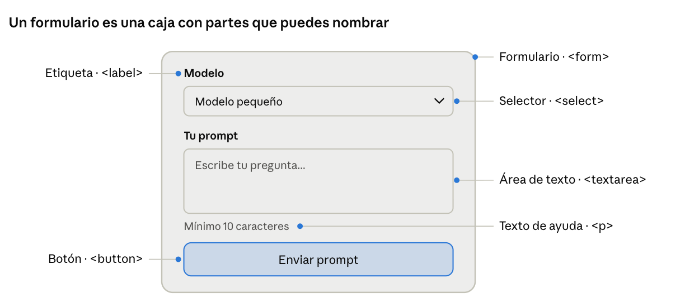
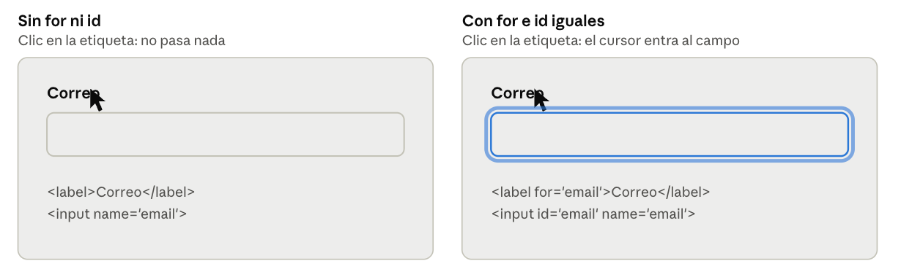
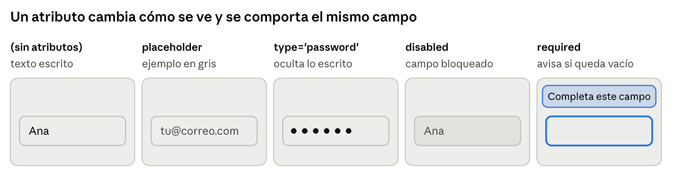
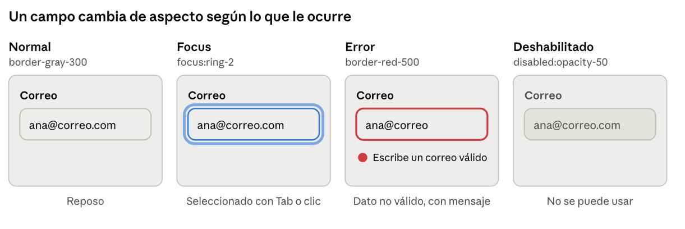
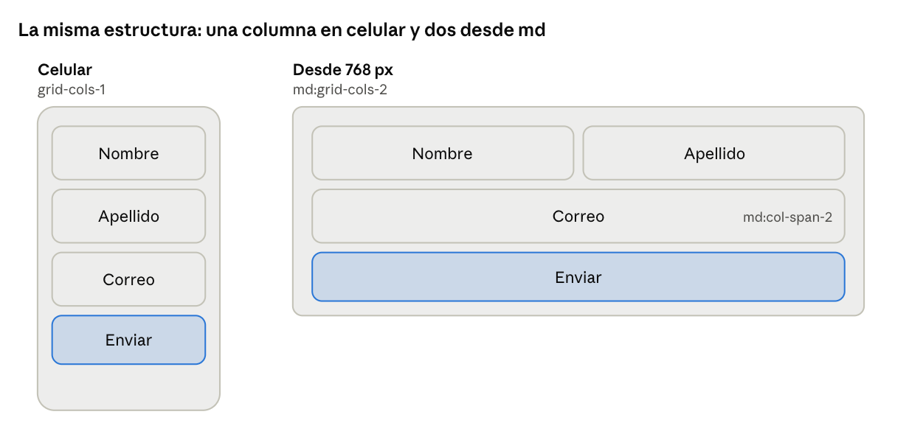
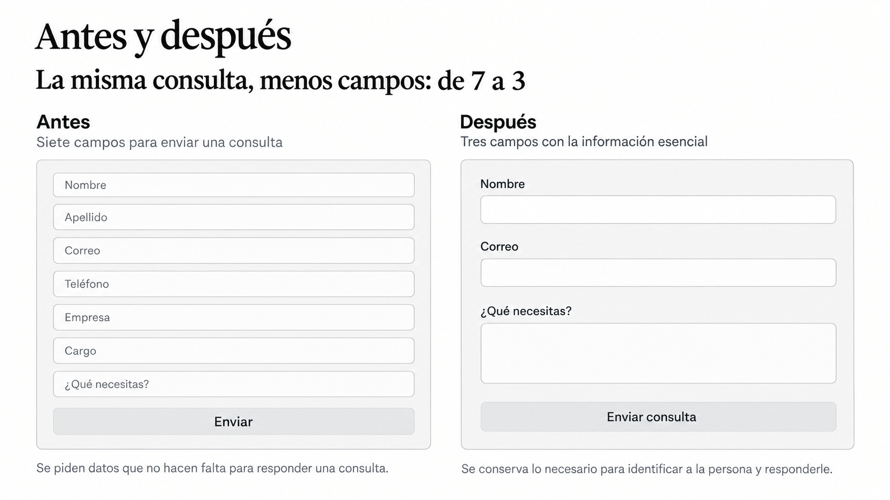
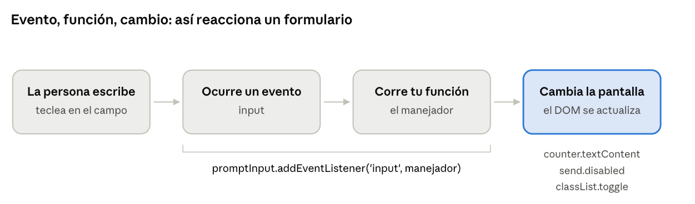
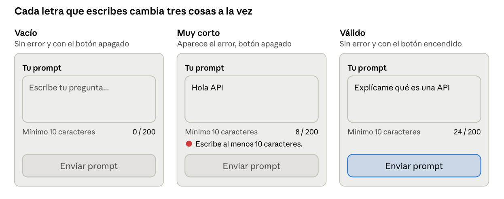

# Formularios que se entienden y responden: HTML, Tailwind y JavaScript

Un formulario es la puerta de entrada de casi todo lo que construyes en IA: ahí la persona escribe su prompt, elige un modelo o ajusta una opción. Si esa puerta es confusa, nadie llega a tu modelo. Este artículo te acompaña en el módulo Developing Forms Using Simple CSS and JavaScript y sigue una regla: cada concepto se ve antes de explicarse. Primero verás qué cambia en pantalla; después, el código que lo provoca.


## Construir un formulario profesional

Un formulario es un conjunto de piezas que trabajan juntas: etiqueta, campo, ayuda y botón. Si aprendes a ver las piezas, dejas de ver "un formulario" y empiezas a ver partes que ya sabes escribir.

### Radiografía de un formulario

Antes de escribir código, mira un formulario real y señala cada parte. Este es el formulario que construirás al final del artículo: enviar un prompt a un modelo.



| Parte | Para qué sirve | Etiqueta HTML |
| --- | --- | --- |
| Formulario | Agrupa los campos y define qué se envía | `<form>` |
| Etiqueta | Dice qué va en el campo | `<label for="...">` |
| Selector | Elegir una opción de una lista | `<select>` con `<option>` |
| Área de texto | Escribir varias líneas | `<textarea>` |
| Texto de ayuda | Explica el formato o el límite | `<p>` |
| Botón de envío | Envía el formulario | `<button type="submit">` |

Cada campo lleva dos atributos importantes: `id`, un identificador único para conectarlo con su etiqueta, y `name`, el nombre con el que viajan sus datos. Esta es la estructura, todavía sin estilos:

```html
<form id="prompt-form">
  <label for="model">Modelo</label>
  <select id="model" name="model">
    <option value="small">Modelo pequeño</option>
    <option value="large">Modelo grande</option>
  </select>

  <label for="prompt">Tu prompt</label>
  <textarea id="prompt" name="prompt" rows="4"></textarea>

  <button type="submit">Enviar prompt</button>
</form>
```

### La etiqueta se conecta con el campo

El valor de `for` en la etiqueta debe coincidir con el `id` del campo. Mira qué pasa cuando haces clic en la etiqueta con y sin esa conexión:



Con la conexión, el clic en la etiqueta lleva el cursor al campo, y los lectores de pantalla anuncian qué se debe escribir. Sin ella, la etiqueta es solo texto suelto.

### Cambia un atributo, cambia lo que ves

Los atributos modifican el comportamiento de un campo sin escribir una sola línea de JavaScript. Compara el mismo campo con cuatro atributos distintos:



- `placeholder` muestra un texto de ejemplo que desaparece al escribir.
- `type="password"` oculta lo escrito. Otros tipos útiles: `email` (valida el formato y muestra el teclado adecuado en el celular), `number` y `checkbox`.
- `disabled` bloquea el campo: no se puede editar ni enviar.
- `required` impide enviar el formulario vacío y el navegador avisa qué falta.


## Estilar formularios con Tailwind

HTML da la estructura; Tailwind le da la apariencia. Para practicar sin instalar nada, agrega esta línea dentro de `<head>` (en un proyecto real se instala con una herramienta de build):

```html
<script src="https://cdn.jsdelivr.net/npm/@tailwindcss/browser@4"></script>
```

### Del campo sin estilo al campo terminado

Cada clase agrega un cambio que puedes ver. Esta es la conexión que tienes que fijar:



```html
<input id="email" name="email" type="email"
  class="w-full rounded-lg border border-gray-300 px-3 py-2
         focus:outline-none focus:ring-2 focus:ring-blue-500">
```

Se lee: ancho completo, esquinas suaves, borde gris, espacio interior y, al enfocar, un anillo azul.

### Los estados de un campo

Un campo no tiene una sola apariencia: cambia según lo que ocurre. Compara los cuatro estados:

| Estado | Cuándo ocurre | Clases de Tailwind |
| --- | --- | --- |
| Normal | El campo está en reposo | `border-gray-300` |
| Focus | La persona lo selecciona con clic o con Tab | `focus:ring-2 focus:ring-blue-500` |
| Error | El dato no es válido | `border-red-500` y un mensaje con `text-sm text-red-600` |
| Deshabilitado | El campo no se puede usar | `disabled:opacity-50 disabled:cursor-not-allowed` |

Un error nunca debe depender solo del color. Una persona daltónica o con baja visión necesita leer qué pasó, por eso el estado de error incluye siempre un mensaje de texto junto al campo.

### El formulario en pantallas distintas

Los prefijos `md:` que viste en el módulo de layout funcionan igual aquí. En celular los campos van en una columna; desde 768 px, nombre y apellido se ponen lado a lado:



```html
<form class="grid grid-cols-1 gap-4 md:grid-cols-2">
  <div>... Nombre ...</div>
  <div>... Apellido ...</div>
  <div class="md:col-span-2">... Correo ...</div>
  <button class="md:col-span-2 ...">Enviar</button>
</form>
```

Leído en voz alta: "una columna en celular, dos columnas desde md, y el correo y el botón ocupan las dos (md:col-span-2)".

## Formularios efectivos, mantenlo simple

Un formulario efectivo no es el que pide más datos, sino el que se completa sin esfuerzo. Tu memoria de trabajo es limitada: cada campo extra es una decisión más, y cada decisión cuesta atención. Simplificar no es recortar por recortar, es proteger la atención de quien te usa.


### Antes y después



A la izquierda hay siete campos donde el texto de ejemplo hace de etiqueta y un botón vago. A la derecha, tres campos con etiqueta visible y un botón que dice qué va a pasar. El objetivo es el mismo; el esfuerzo, no.

### Seis reglas para decidir

| Regla | Por qué funciona | Cómo se ve en el código |
| --- | --- | --- |
| Pide solo lo necesario | Cada campo es un esfuerzo; si no vas a usar el dato, no lo pidas | Menos `<input>` |
| Una sola columna por defecto | El ojo recorre la pantalla de arriba abajo sin saltos | `space-y-4` o `grid-cols-1`; dos columnas solo para datos cortos y relacionados |
| Etiqueta siempre visible | El placeholder desaparece al escribir y se olvida qué era el campo | `<label for>` y placeholder solo como ejemplo |
| Botón con verbo concreto | "Enviar prompt" dice qué ocurrirá; "Enviar" no | El texto del `<button>` |
| Error claro junto al campo | Un mensaje concreto dice cómo corregirlo | Texto con `text-sm text-red-600` bajo el campo |

## Formularios dinámicos con JavaScript

Hasta ahora el formulario es estático: se ve bien, pero no reacciona. JavaScript le da esa capacidad: observa lo que hace la persona y actualiza la pantalla. 



### La idea: evento, función, cambio

Son tres piezas que siempre aparecen juntas:

- Un evento es algo que ocurre: escribir, hacer clic, enviar.
- Un manejador es la función que tú escribes para responder a ese evento.
- El DOM es la página viva: cuando tu función lo modifica, la pantalla cambia.

| Evento | Cuándo ocurre | Úsalo para |
| --- | --- | --- |
| `input` | Cada vez que cambia lo escrito | Contadores y validación en vivo |
| `change` | Al confirmar un cambio, como elegir una opción o salir del campo | Mostrar u ocultar campos según una elección |
| `submit` | Al enviar el formulario | Leer los datos |

### El formulario cambia con el código

Mira el mismo formulario en tres momentos. Lo único que cambia es lo que escribe la persona; todo lo demás lo hace el código:



# Del código estático al agente autónomo

Ya sabes estructurar un formulario, darle una apariencia profesional con Tailwind y conectarlo a la lógica del navegador. En el desarrollo de IA, no siempre querrás escribir cada línea desde cero; a menudo utilizarás agentes para prototipar rápidamente tus interfaces de pruebas (playgrounds, selectores de modelos, paneles de parámetros).

Para lograr que una IA te devuelva exactamente lo que necesitas sin caer en formularios confusos o genéricos, la clave está en darle instrucciones precisas basadas en los principios que acabas de aprender.

Aquí tienes un prompt de ejemplo que puedes usar con cualquier asistente de código para generar un formulario profesional en segundos:

> "Actúa como un Frontend Developer experto en IA y UI/UX. Construye un formulario profesional para configurar parámetros de un LLM (modelo, temperatura, prompt). Debe utilizar etiquetas semánticas con sus respectivos `for` e `id`, diseño responsivo con Tailwind (`grid-cols-1 md:grid-cols-2`), estados visuales completos (`focus`, `disabled`, errores explicativos) y un botón con un verbo de acción concreto. Entrégame el código completo y listo para probar."
